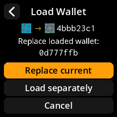
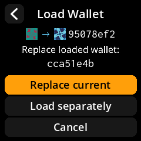
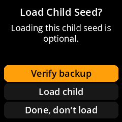
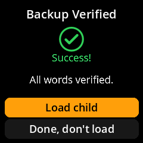

# Follow-up to the PR 2–5 review

The attached review evaluated earlier commits in PRs 2–5. All four PRs have
since been merged into this fork's `dev`. These follow-up changes address the
findings without undoing the requested two-LifeHash display or passphrase policy.

| Finding | Response |
| --- | --- |
| PR 2: discard identity checks, state cleanup and menu clipping | No change needed; existing protections and regression tests retained. |
| PR 3: translated discard warning regressed | Restored the existing `Wipe seed {} from the device?` message and substitute the actual discarded wallet's XFP. Its LifeHash remains visible. |
| PR 3: first-render LifeHash cost | Icons now generate on first display or explicit image access, avoiding work for offscreen menu rows. Each icon retains its canonical image. The public shared cache remains bounded at 16 entries. Device timings are still pending. |
| PR 3: later-layer hooks / old three-tile header | The later layers are already merged. The current display remains limited to two LifeHashes, covered by existing tests. No three-tile path is restored. |
| PR 4: replacement target absent when editing | Load Wallet now explicitly labels the loaded wallet's current XFP as the replacement target below the derivation display. Bare mnemonic → candidate remains correct for passphrase derivation; the old passphrase is not an input to the new one. |
| PR 4: empty addition asks to remove a nonexistent passphrase | Empty submission on a bare wallet returns to its seed menu without a removal prompt or any storage/workflow-state change. Removal from a passphrased wallet retains the existing confirmation. |
| PR 4: Required still permits removal | The passphrase-specific label is now **Always ask**. Its persisted `R` value is unchanged. This implements the requested policy: prompt during initial loading, allow Skip and later removal. Other Required settings are unchanged. |
| PR 4: missing translation-template strings | Regenerated `l10n/messages.pot`, including passphrase, replacement, BIP-85 and Always ask labels. Extraction also synchronizes preexisting changes elsewhere in the source tree. New language translations still need the normal translation-project workflow; extraction does not supply them. |
| PR 5: sibling replacement target absent | Load Wallet separately labels the original loaded child's XFP, including its own passphrase if present. The two LifeHashes remain actual deriving parent → candidate sibling. |
| PR 5: inversion needs physical testing | Automated driver/color tests remain passing, but the user's successful physical test of `5955b14` predates inversion compensation. A new device run is still required; see checklist below. |
| PR 5: opposite-polarity display modules | Supported ST7789 and ILI9341 IPS panels retain their documented INVON mapping. Unknown opposite-polarity modules need an explicit hardware configuration and testing; their polarity cannot be inferred from software. No unverified generic-panel support is claimed. |
| PR 5: child backup forces loading | Added **Done, don't load** both before and after backup verification. It returns to the deriving wallet, or the original child during an index change, without loading/replacing anything. Stale source identities fall back to In-Memory Seeds/Home. |
| PR 5: dark palette / Back-navigation scope | These were requested and already merged. They remain separate implementation commits (`5955b14` and `2ab7755`) and can be reviewed/reverted independently. No rollback or rewriting of the merged PRs is needed. |

## Native screen evidence

Images are unscaled 240×240 captures from `tools/passphrase_preview.py`, using
only public demonstration seeds. The mnemonic is `abandon` eleven times plus
`about`. Review and load-choice pairs use the same candidate.

For passphrase editing, the loaded wallet uses `preview` (`0d777ffb`), the
candidate uses `preview2` (`4bbb23c1`), and the bare baseline is `73c5da0a`.
For the sibling example, parent `0d777ffb` derives 12-word child index 0
(`cca51e4b`) and candidate index 1 (`95078ef2`), both without child passphrases.
The loaded XFP is a separate text label, not a third derivation tile.

| Passphrase replacement target | BIP-85 sibling replacement target |
| --- | --- |
|  |  |

| Backup prompt | Verified backup |
| --- | --- |
|  |  |

## Validation and remaining device checks

- 666 local non-screenshot tests passed on Python 3.12, including exact C++
  reference vectors, supported display inversion states, replacement identities,
  backup-only exits, stale sources, pending seed preservation, and offscreen
  rendering. An independent follow-up code review found no actionable defect.
- Generated 52 native preview PNGs and inspected the changed screens at 240×240.
- Parsed the regenerated 395-entry translation template and confirmed the new
  workflow labels and original translated discard warning are present.
- The attached review independently reports zero mismatches against the pinned
  C++ reference for 20,006 fingerprints. That is the reviewer's result; this
  follow-up reruns the repository's reference-vector tests rather than claiming
  another independent 20,006-input comparison.

The following require a physical device with firmware containing these fixes:

1. At cold boot and after live toggles, compare known LifeHashes with **Invert
   colors** enabled and disabled. Their visible colors should remain stable;
   surrounding UI may invert. Toggle both ways (Enabled → Disabled → Enabled),
   because the panel's normal startup INVON state can make the initial Enabled
   selection appear unchanged.
2. Time a cold In-Memory Seeds render, scrolling, the PSBT seed picker, and a
   multisig key page. Include more than 16 unique fingerprints to exercise cache
   eviction. Lazy icons avoid offscreen generation but do not eliminate all
   recomputation or establish Pi Zero performance measurements.
3. Edit a passphrased wallet and change a child index: verify the replacement
   label identifies the entry actually replaced, including a passphrased child.
   Verify Load separately retains it.
4. Copy a child mnemonic and choose Done, don't load, both before verification
   and after verification. Confirm no new entry was loaded and the original
   parent/child remains selected.
5. With Always ask selected, confirm initial loading prompts, Skip remains
   available, an empty addition on a bare wallet returns safely, and removal from
   a passphrased wallet still requires confirmation.
